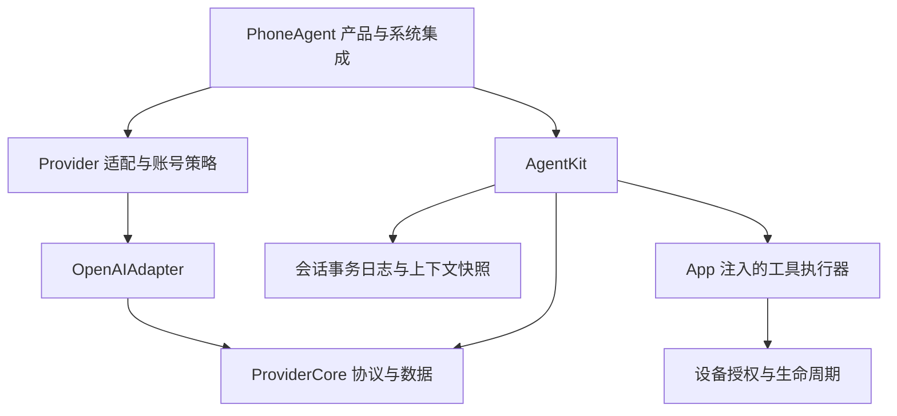
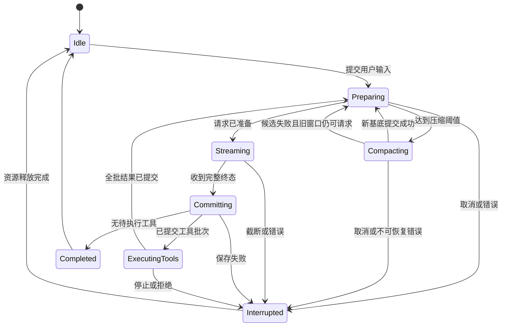

# AgentKit 设计与实施约束

本文定义 AgentKit 的模块边界、持久化与上下文契约、失败恢复和验证要求。实际公共接口见 [AgentKit](../ios-app/AgentKit/README.md)，磁盘布局与迁移见 [会话存储](CONVERSATION-STORAGE.md)。

目标是在 `ios-app/AgentKit` 从零建立 Agent 核心，与 `ios-app/ProviderKit` 平级。AgentKit 管理事件循环、工具调度、流式输出、会话历史、上下文窗口和压缩；ProviderKit 管理模型协议与传输。会话持久化采用 JSONL 事务日志，并分别生成 UI 历史和模型有效上下文。

## 1. 实施边界和必须成立的结果

### 1.1 从零构建的边界

- 删除 `ios-app/Vendor/SwiftAgentKit` 及其宏、产品依赖和构建引用。不 fork、不包装、不复制、不移植其实现，也不保留通过类型别名调用旧框架的兼容层。
- 不以该框架的源码、文档、内部类型设计、算法或测试作为新 AgentKit 的设计资料。旧符号只用于识别 App 调用边界和移除项目引用。
- 可使用本项目自有 ProviderKit、App 的设备执行／授权契约、公开协议，以及用户指定的《Codex JSONL 历史、UI 与上下文压缩》文档。
- App 自有测试用于保留产品行为要求，按新接口重写；只测试旧依赖内部存储实现的用例退出，不能替代或删减授权、未知结果、不重放、迁移和停止释放覆盖。
- 旧数据兼容限于本项目自有持久化格式。迁移器不链接旧框架，不实例化旧 Agent，也不借助旧框架恢复执行。

### 1.2 首版交付范围

必须一次覆盖以下闭环，不能以“先替换名称、后补上下文”作为改造完成标准：

1. 普通对话、连续多轮对话、一次响应中的多个工具顺序执行。
2. 文本／可读思考流式展示，最终响应校验，取消与错误收敛。
3. 完整会话历史保存、分页读取、进程重启加载和可重建的紧凑会话列表。
4. 独立的模型上下文投影，保留工具调用／结果关联和支持的原生响应项。
5. 有预算的上下文管理、原生压缩和通用摘要压缩。
6. 稳定请求前缀、缓存字段与用量统计、压缩后继续建立缓存。
7. App、Siri、Live Activity、后台生命周期、Muse 直接工具入口完成解耦。
8. 旧会话可读、旧执行不重放；迁移验证并提交成功后清理旧历史的临时恢复数据，不永久保留旧格式副本。
9. 可恢复故障处理后仍能接受后续有效请求；列表缓存、统计或清理失败不使会话永久停留在运行／恢复中。

首版不包含多 Agent、规划器、向量记忆、任意模型输出自动修复、受理不明的请求重试、服务端 Conversations、后台 Responses、自动续跑中断任务或跨设备同步。允许下文明确规定的本地数据重建、能力降级及有界的未受理请求恢复。运行预算用可选值表达；不再用 `Int.max` 伪装无限制，也不新增未经产品确认的固定任务轮数上限。

### 1.3 可用性与故障范围

运行可用性、数据正确性和可恢复性同为交付要求。检查规则必须说明它保护的具体事实、失败影响范围和恢复出口；不能以不断增加拒绝条件代替恢复设计。

- 列表概要、展示投影、缓存命中信息、诊断归档和统计是可降级数据，不能成为执行主流程的成功前提。
- 候选响应、候选上下文和迁移中间产物验证通过后才成为权威状态。失败候选不能污染下一轮，也不能通过清空历史、补造成功或删除未知动作来恢复表面可用性。
- 协议、作用域、授权和副作用提交等必要检查保留，但只限制依赖该事实的请求或动作；普通工具错误返回模型，派生数据错误重建，非必要字段缺失采用显式默认值或 unknown。
- 确需结束当前 turn 时，退出、取消和资源释放有明确路径；下一次合法 turn 不继承一次性的错误标记。外部条件尚未恢复时明确返回原因，不无限等待，也不阻塞其他无关会话。
- 同一边界只维护一份校验规则。ProviderKit 负责协议完整性，AgentKit 负责事务与调度，App 负责实时设备授权；不在每层重复设置彼此矛盾的拒绝条件。

## 2. 上下文管理的替换边界

以下原有行为来自本项目调用层与 ProviderKit，是本方案替换的边界，不依赖旧框架内部实现。各层当前职责与逐文件接入理由见 [分层接入说明](AGENTKIT-INTEGRATION.md)。

| 位置 | 原有行为 | 实现要求 |
| --- | --- | --- |
| [ConversationStore.history](../ios-app/PhoneAgent/Storage/ConversationStore.swift) | 从 UI 消息取最近 16 条完整用户／助手文本，去掉 reasoning；工具和附件不在返回的上下文中 | 模型输入不再由 UI 列表或固定消息条数构造 |
| [AgentViewModel.send](../ios-app/PhoneAgent/Agent/AgentViewModel.swift) | 每次发送创建新的运行和 provider，再把上述文本加入 Agent | 会话上下文跨用户回合存在，运行身份与上下文身份分开 |
| 同上 | Chat 路径配置固定上下文／消息数量；Responses 路径使用近乎无限的窗口值 | 由实际模型能力和预算管理两种协议 |
| 同上 `afterTool` | 每次收到工具图片后改写运行中的历史图片字段 | 已提交历史不可变；图片保留／移出上下文通过有记录的窗口转换完成 |
| 原 `ContextCoordinator` | 用重建消息的摘要、预期助手文本、运行级 checkpoint 推断增量；另行裁剪设备图像 | 由 AgentKit 用稳定 item ID、提交序号和上下文 revision 管理追加与替换；ProviderKit 仅保留纯格式投影 |
| [PrivateVisionProvider](../ios-app/PhoneAgent/Agent/Providers.swift)、[ChatGPTSubscriptionProvider](../ios-app/PhoneAgent/Agent/ChatGPTSubscriptionProvider.swift) | provider 内部准备／提交上下文并写 provider checkpoint | provider 不再拥有会话历史或决定上下文 head |
| [ProviderCore.NativeItems](../ios-app/ProviderKit/Sources/ProviderCore/NativeItems.swift) | 压缩能力为固定关闭；无专用压缩输入／返回类型 | 增加显式能力和压缩协议，不把任意 unknown item 当作压缩项 |
| [ConversationJournal](../ios-app/PhoneAgent/Storage/ConversationJournal.swift) | 保存 UI 消息 upsert；文件变大时重写当前 UI 快照 | 与新的执行／上下文事务日志区分，不能把文件整理称作模型压缩 |
| 原 App `ModelStreamDecoder` | Chat 流用量读取未保留 cached token 细项；部分流事件 yield 未检查丢弃 | 缓存统计和流完整性统一进入 [ProviderKit 解码器](../ios-app/ProviderKit/Sources/OpenAIAdapter/ModelStreamDecoder.swift) |
| [AgentLimits](../ios-app/PhoneAgent/Models/Models.swift) | 以非可选大整数适配旧循环 | 改为明确、可选的运行预算 |

这些行为共同造成：磁盘上有历史，不代表下次模型拿到完整历史；继续同一会话也不能延续同一份原生上下文。更改消息文本或图片还会破坏增量判断和缓存前缀。不能只增加一个摘要函数解决这些问题。

## 3. 包结构和职责

```text
ios-app/
├── ProviderKit/
│   ├── Sources/ProviderCore/
│   ├── Sources/OpenAIAdapter/
│   └── Tests/
├── AgentKit/
│   ├── Package.swift
│   ├── README.md
│   ├── Sources/AgentKit/
│   │   ├── Domain/          # 身份、会话项、事件、错误、策略
│   │   ├── Runtime/         # 单会话事件循环、取消、运行句柄
│   │   ├── Tools/           # 注册、批次校验、调用与结果
│   │   ├── Context/         # 上下文投影、预算、请求规划、压缩
│   │   └── Persistence/     # JSONL、二进制附件、展示投影、加载、恢复
│   └── Tests/AgentKitTests/
└── PhoneAgent/              # 产品、账号、设备、权限和系统生命周期
```

首版只有一个 `AgentKit` library target，依赖 `.package(path: "../ProviderKit")` 的 `ProviderCore` 产品，使用 Swift 6.2；平台下限与 ProviderKit 保持一致，App 仍遵循自身 iOS 下限。主要基础设施使用 Foundation 和 CryptoKit，不引入宏、另一套 Agent 框架或第二套模型 SDK。



| 层 | 负责 | 不负责 |
| --- | --- | --- |
| ProviderCore | 模型请求／响应、可回放项、用量、能力、请求归属与压缩协议 | 会话目录、UI、工具执行、挑选保留历史 |
| OpenAIAdapter | Chat／Responses 编解码、SSE、响应完整性、受支持的原生压缩和缓存字段 | 上下文 revision、是否应压缩、动作授权 |
| AgentKit | 会话日志、上下文投影、循环、顺序工具批次、预算、压缩策略、恢复 | 凭据保存、设备协议、系统后台权限、UI 文案 |
| PhoneAgent | Provider 配置与授权、设备工具、用户审批、附件导入、Siri／Live Activity／后台、展示本地化 | 重建模型历史、隐式修改 Agent 上下文 |

`ContextCoordinator` 的会话编排职责由新的 AgentKit 实现替代；其中仍需要的纯格式校验应独立留在 ProviderKit。最终不能让新 AgentKit 和旧 coordinator 同时维护两份 continuation 状态。

## 4. 身份、数据模型与公共接口

### 4.1 身份不能互相代用

| 身份 | 生命周期和用途 |
| --- | --- |
| `SessionID` | 一段持久化对话，继续聊天不改变 |
| `TurnID` | 一次用户请求到完成／中止；映射 App 的一次 Run |
| `InferenceID` | 一个回合中的一次模型请求；工具后可有下一次 |
| `AttemptID` | 一次实际网络尝试；不代表允许自动重试 |
| `ItemID` | 本地历史项稳定身份，流更新和最终结果共用 |
| `CallID` | provider 的工具关联 ID；另存 provider output item ID，不混用 |
| `ContextEpochID` | 一份兼容的上下文基底；压缩、切换模型／服务域或指令策略转换时改变 |
| `contextRevision` | 上下文每次已提交变更递增，用于 CAS |
| `runGeneration` | 当前运行代际；取消立即使旧代际失效 |
| `sequence` | 单会话日志事务顺序，与 UI 回合号无关 |

将当前 `ProviderScope` 拆成稳定的 `ProviderReplayScope` 和请求归属：前者含 provider、规范 endpoint、account reference、project、model、session；后者含 turn、inference、attempt。`ContextEpochID` 和 revision 属于本地窗口身份，单独保存，不能混入每个原生项必须完全相等的服务域判断。压缩后的窗口可以明确引用同一服务域内较早 epoch 的保留项，但必须在已提交的窗口成员表中。不能继续把每次发送产生的随机 run ID 当成所有历史原生项的有效域。

凭据字符串不进入 scope、缓存 key、历史或摘要。作用域身份变化时不能“重新盖章”让旧加密块跨域使用；必须按第 9 节重建上下文。

运行去重键至少包含 `(SessionID, TurnID, CallID)`，同一回合跨模型迭代也不能再次领取已用 call ID；有效原生输入中还要验证 call ID 不冲突。不同会话不共享去重表。新 epoch 的生成本身不清除设备侧已领取记录，不能借压缩绕过不重放约束。

### 4.2 两种视图由同一批已提交事实生成

持久化的核心项建议为：

- `UserInputItem`：原文、附件引用、来源和发送授权范围。
- `ModelOutputItemRecord`：原始顺序、响应归属、文本／拒绝／可读思考／工具调用／受支持原生项。
- `ToolResultItem`：call ID、结构化结果、错误分类、附件和送达语义。
- `ContextSnapshot`：基底引用、覆盖边界、窗口、兼容域与 token 估计质量。
- `TurnRecord`：输入、阶段、起止和中断原因。

UI 的 `DisplayItem` 从这些事实投影；模型的 `ContextView` 只选择可回放项。不能再把 `ChatMessage` 当成模型输入的真实来源，也不能把 UI notice、tool 状态字符串或可读思考默认转换为用户消息。

ProviderCore 已有 Codable 的原生项可作为边界类型，但 AgentKit 的磁盘 schema 单独版本化，通过 `DurableInput`／`DurableOutput` 显式编码；不能将 Swift enum 的默认编码布局直接当作长期格式。

### 4.3 公共接口

核心调用入口如下；配置、工具和 SessionStore 在初始化 runtime 时注入：

```swift
public actor AgentRuntime {
    public func createSession(id: UUID = UUID()) async throws -> UUID
    public func loadSession(_ id: UUID) async throws -> SessionHandle
    public func startTurn(in session: UUID, input: TurnInput, turnID: UUID = UUID()) async throws -> TurnHandle
    public func cancelTurn(_ turn: UUID, reason: StopReason = .user) async
    public func compactSession(_ session: UUID, strategy: CompactionStrategy = .automatic) async throws -> CompactionOutcome
}

public protocol SessionStore: Sendable {
    func append(_ transaction: SessionTransaction,
                expecting: Int) async throws -> CommitReceipt
    func readPage(_ query: HistoryQuery) async throws -> HistoryPage
    func loadContext(_ session: UUID) async throws -> RestoredContext
    func readTransactions(_ session: UUID) async throws -> [SessionTransaction]
    func readContextFacts(_ session: UUID) async throws -> [SessionTransaction]
}

public protocol AgentTool: Sendable {
    var descriptor: ToolDescriptor { get }
    func execute(_ invocation: ToolInvocation,
                 context: ToolExecutionContext) async throws -> ToolOutcome
}
```

`loadContext` 返回运行所需的基底、增量和调用账本，不伪装成完整历史；底层扫描仍验证已提交记录与必要图片引用。`readTransactions` 必须由存储显式实现，不能默认为空数组；`readContextFacts` 为上下文重建读取已提交事实，不能把缺失的必要记录当作空内容继续。旧内部格式的纯派生压缩内容缺失只可按第 13 节转换为显式缺口并重建公开事实，严格审计仍报告缺失；新内联日志的完整行损坏不能跳过。

`loadSession` 只恢复数据，不发模型请求、不恢复待执行工具、不获取设备授权。`TurnHandle` 提供完成结果及事件订阅，UI 取消订阅不取消任务；停止任务必须调用显式取消入口。

跨 actor 的值类型必须满足 Sendable，持久化类型显式 Codable。JSON 参数以类型化 `JSONValue`／只读字节传递，`[String: Any]` 只在协议或 App 工具适配边界内短暂构造；不通过大量 `@unchecked Sendable` 回避隔离设计。

## 5. 事件循环和并发规则

### 5.1 单会话单写者

每个会话只有一个 `SessionEngine` actor 和一个写入队列。App 的 runtime registry 对同一会话返回既有实例；存储层再持有独占文件锁，真实存在另一 writer 时返回可恢复的 busy，不创建第二个 writer，也不写入永久锁死标记。锁文件或历史 `running` 字段的存在不代表仍有活跃持有者。不同会话可以并发推理，设备执行仍遵守 App 现有的设备占用规则。

actor 内部等待网络、工具和落盘时会发生重入，因此 actor 本身不等于并发正确。每个返回结果都携带 `(TurnID, runGeneration, contextRevision, InferenceID)`，在提交和派发之前重新校验。首版同一会话运行中不接受第二个 turn，也不实现运行中 steering；用户的新输入保留为草稿。

### 5.2 基本状态机



工具内的等待授权、正在发送和结果未知是独立状态，不用一个 `running` 布尔值代替。压缩不计入设备动作数；用量按任务推理和压缩分别归集。

### 5.3 一次迭代的提交顺序

1. 保存 `turn.accepted` 与用户输入，取得明确的提交回执后才启动网络工作。
2. 从当前 `ContextView` 准备请求；检查上下文预算、权限域、工具表、附件完整性。
3. 保存请求身份、基底 revision、输入指纹及授权引用；不保存 token 或 Authorization header。
4. 消费 ProviderKit 的流。增量只更新预览和可选的部分输出记录。
5. 得到完整终态后校验整批调用、顺序与关联；将最终模型项、用量、上下文推进及待处理调用写入同一个事务。
6. 事务成功后按响应中的顺序执行工具。每个工具结果先持久化，再执行后续工具／发下一次模型请求。
7. 全批工具产生终态结果后再准备下一次请求；无工具时结束本轮。没有最终文本且没有有效工具结果的空响应不能伪装成任务成功。

网络 EOF、HTTP 200、单个 item 完成和工具参数看起来完整，都不是执行工具的充分条件。默认不自动重试模型请求；明确的“服务端未执行／未受理”错误也只在单独定义并测试的策略下处理。

### 5.4 等待、失败和退出

网络首包／空闲、工具调用、审批和存储操作分别定义可取消的等待与到期行为，沿用已有合理的操作超时；不新增覆盖整个长任务的任意总时限。运行中的等待不能持有全局 registry 锁，也不能让 UI 订阅或诊断写入反向阻塞引擎。

每个阶段都必须覆盖正常完成、失败和取消的退出路径。统一释放活动任务占用、订阅和已结束操作持有的资源；必要的工具组恢复由第 6.3 节处理，不依赖“先成功写下一条错误日志”才能退出内存中的运行态。错误通知本身失败不能再递归写错误而形成循环。

超时或取消不等于底层 I/O 已终止。旧代际的晚到结果不能继续发布或派发；仍在写入的文件操作、仍在送达中的设备动作必须隔离并确认终止／结果后才能复用相应资源，不能通过清除 busy 标记造成双 writer 或重复动作。其他可用资源和会话照常工作。恢复数据不会自动续跑旧 turn，用户新发起的 turn 在必要恢复完成后可正常启动。

## 6. 工具调用与设备安全契约

### 6.1 工具定义

`ToolDescriptor` 包括稳定名称、说明、JSON schema、效果类别、输出容量预算和是否允许用于摘要。首版摘要工具集为空，不允许摘要任务执行任何工具。

所有工具直接实现协议或使用普通 Swift 闭包注册，不使用宏。采用 ProviderCore 的 schema 边界，工具参数解码与业务验证分开：协议层检查完整 JSON、ID 和名称；工具实现检查坐标、数值范围和业务条件。

整批收到重复 call ID、缺失 ID 或不完整／不可解码的协议参数时，任何调用都不能先行执行，且不将无效批次提交为可回放模型输出。协议完整但工具未注册、参数不符合该工具业务 schema 的单次调用返回 `validationFailed`，让模型决定下一步，不把普通工具使用错误升级为会话故障。其余调用仍按既定顺序和授权规则处理；不能由 runtime 自动修正参数重试。

### 6.2 授权与事实来源

App 的 `ActionCoordinator`、`RunLifecycleCoordinator`、`ApprovalRecordStore` 继续负责设备 readiness、单次授权、参数摘要、送达状态和停止释放。剥离其旧框架参数／结果包装，改用新的 `ToolInvocation`／`ToolOutcome`。

设备调用同时关联 AgentKit 调度记录和设备执行检查点：前者说明模型请求了什么、结果是什么；后者对“是否可能已经向设备发送”具有权威性。两者不进行危险的跨文件假原子提交。

```text
AgentKit 提交工具调用和调用领取记录
  → App 校验权限并保存实际 dispatching 状态
  → 最后一刻校验运行代际和设备会话
  → 发送动作
  → App 保存送达／未知结果
  → AgentKit 保存工具结果
  → 允许下一步
```

权威历史提交、调用领取记录或设备 dispatch 检查点失败时，不能继续派发依赖这些记录的后续动作。state 列表概要、UI 投影、可选预览快照、统计或诊断文件失败不撤销已提交事实，不阻止原本合法的执行；同一历史文件若发生部分写入，必须先完成尾部恢复再追加。取消先使共享代际 fence 失效并撤销执行许可，再取消网络、写入停止状态及释放设备；即使停止状态落盘失败，也必须在内存中阻止旧任务的新动作。

### 6.3 结果分类和恢复

`ToolOutcome` 明确区分 `returned`、`validationFailed`、`denied`、`cancelledBeforeDispatch`、`outcomeUnknown` 和 `infrastructureFailure`。`acknowledged` 只是送达，不自动转为设备效果已验证。

- 正常运行中，结果未知可以作为明确的错误结果返回模型，允许后续新的观测；禁止 runtime 重试相同调用。保留现有“观测后作出不同下一步”的能力。
- 用户拒绝或明确停止后，不运行批次中剩余调用，包括只读工具。
- 崩溃时已领取但无结果的调用按未知处理；仅 prepared 的调用也不自动执行。
- 如果设备检查点说明已发送，而 AgentKit 缺少结果，恢复时写入明确的恢复事实，不能补造成功内容。
- 历史加载／UI 展示不会执行任何工具。历史摘要也不能作为新的设备许可。

停止或崩溃后的工具批次必须在下一次模型请求前闭合：已提交但未派发的调用追加 runtime 产生的 `cancelledBeforeDispatch` 结果；可能已派发的调用追加 `outcomeUnknown` 恢复结果，并标明结果来源。它们是对真实状态的描述，不伪装成工具成功返回。这样既不重放动作，也不会把缺失 `function_call_output` 的半个工具组发送给下一次推理。

## 7. 流式处理

### 7.1 ProviderKit 先提供统一、可信的终态

保留 ResponsesReducer 对 sequence、response/item scope、重复事件、工具参数和终态一致性的检查。Chat 的 `ModelStreamDecoder`、可读 reasoning 解析等纯协议处理移入 OpenAIAdapter，清除其对 AppError 和 App 文案的依赖。

AgentKit 的正式输入流只接受一个权威 `terminal(ModelResponse)`；迁移 DemoProvider 和测试夹具，不再以 `.finish` 和 `.terminal` 两套完成语义驱动循环。工具 delta 只提供预览；只有已验证 terminal 内的完整批次可以进入调度。

补充带响应／item 地址的 delta 类型，避免把所有文本和 reasoning 拼在一个不可定位的字符串中。UI 的 `ItemID` 在开始时创建，最终响应按 provider item 地址替换该项的权威内容，不把最终全文再次追加到流式文本后面。

### 7.2 背压和中断

推理流和 UI 订阅分离：

- Provider → Engine 使用可等待消费者的有界通道，优先通过背压处理短暂拥塞；所有 yield 必须检查结果。仅可合并可重建的预览，原始协议帧、参数组装所需片段、工具、终态和错误不能丢失。无法维持完整性或操作超时才结束当前响应，不能因 UI 暂时变慢就中断任务。
- Engine → UI 可合并进度和文本预览。订阅者落后时发送“从 sequence 重新读取快照”的信号，而不是丢掉文本 delta 后继续假装正文完整。
- 部分文本可按时间／字节阈值合并保存，终态、工具结果、授权／取消和压缩提交立即保存。建议初值为 250 ms 或 4 KiB，实际阈值由性能测试确定。
- 断流／取消时部分文本仍可展示为中断，不作为成功助手输出加入下一次模型上下文；新回合只得到显式中断记录和完整的既有事实。

App 后台仍处理执行事实和持久化，但暂停对隐藏 SwiftUI 页面的高频发布；回前台再读取一次投影快照。Live Activity 的更新保留独立节流与终态等待规则，不把 Agent 的每个 token 直接广播到系统活动。

未知扩展事件在通过必要的顺序／作用域检查后可继续处理；诊断保存达到上限时截断诊断并记录计数，不因非执行扩展的归档配额耗尽而中断有效响应。协议解析和核心完整性检查仍有独立资源上限。扩展事件不能推导工具执行或成功终态。加密 reasoning／压缩块只进入受保护的回放存储，不投影到 UI 或普通日志。

## 8. JSONL 会话持久化与加载

### 8.1 与现有会话目录衔接

沿用 App 的 `YYYY-MM-DD_<会话 UUID>` 目录规则和附件身份；日期取会话创建时间的 UTC 日期，不随继续聊天或时区改变而重命名。持久化文件直接放在会话根目录，不增加 `agent/` 层级。AgentKit 接收的存储 URL 就是会话目录，不知道 App 的 Documents 路径或日期目录规则。

```text
Documents/
├── state.json                         # 可重建的紧凑会话列表
└── sessions/
    ├── format.json                    # App 总目录初始化标识
    └── YYYY-MM-DD_<会话 UUID>/
        ├── history.jsonl              # 首行会话头，其后完整内联事务
        ├── attachments/
        │   ├── <sha256>               # AgentKit 二进制图片
        │   └── <附件 UUID>/            # App 导入／展示附件及其元数据
        ├── run-checkpoint-v1.json      # App 设备执行检查点
        └── run-recovery-v1.json
```

会话持久化以完整 `history.jsonl` 为权威来源，不另写会话级 `manifest.json`、`metadata.json`、`history.index` 或每事务 blob。文本、消息 metadata、草稿、附件引用、原生续接状态和压缩基底直接保存在 JSONL 中。移除独立 metadata 文件不等于删除日志中的 metadata 字段。只有二进制图片字节存为内容摘要附件；它们与 App 既有 UUID 附件目录并存。

App 的 `state.json` 只保存可重建的列表概要与复用判断所需的信息，不携带完整草稿、附件清单或模型上下文。读取逐条核对已有概要和对应历史，仅对缺失或变化的会话重建；旧概要布局首次读取时从日志重建，不复用尚未转换的会话概要；列表缓存写失败不撤销日志提交，也不阻塞 Agent。展示和运行需要的完整信息仍从会话历史读取。

迁移临时文件和状态标记只用于未完成操作的恢复；完整临时 JSONL 校验、同步后原子替换 `history.jsonl`，该发布本身是提交点。成功后清理旧辅助文件、旧事务 blob 与本次临时来源，不保留永久旧格式副本。不同来源格式的识别与恢复见第 13 节，不把这些输入描述成连续发布版本。

日志和二进制附件使用完整数据保护。受保护数据暂不可访问时结束依赖其提交的操作并停止设备输入；重新可访问后核实存储，允许新的 turn，不把一次保护错误永久标成损坏，也不降低保护级别维持后台工作。引用只使用经过验证的相对标识和内容摘要，拒绝目录逃逸、符号链接和跨会话引用。诊断脱敏与原样回放存储分开，不改写 opaque 续接内容。

### 8.2 首行声明会话，后续行内联完整事务

`history.jsonl` 首行声明 schema 和 session 身份，可包含必要迁移来源标识；不依赖另一个 manifest 文件才能识别会话。后续每个换行结束的记录包含事务身份、顺序、context revision、校验信息和完整 `DurableTransaction`，正文直接内联，不通过摘要定位另一份事务文件。

当前会话头使用 `type="session"`、`schemaVersion=2` 和 `sessionID`，可附带 `migrationID`、`sourceDigest` 与兼容恢复所需的 `missingCompactionIDs`。事务记录使用 `type="transaction"`、相同 schema 和 session 身份，保存 `sequence`、`revision`、`transactionID`、`payloadDigest` 及完整 `transaction`；`missingCompaction` 仅用于已确认的兼容缺口。摘要用于校验内联正文，不再定位外部事务文件。

事务正文包含 `kind`、`turnID`、上下文增量、展示项及 metadata、工具领取／结果、可选用量、上下文 head 或压缩 snapshot。二进制图片按摘要引用，文本和 opaque 状态保持原样内联。普通回复只追加增量与小型 head；仅压缩、跨域重建或恢复发布完整基底。事务实际发生时间用于展示，不替代 sequence；重入与重读按事务身份幂等。可选 usage／缓存字段缺失或无效时按协议保留 unknown，不能连带拒绝完整正文和工具输出。

初始事件集合：会话建立／元数据更新、turn 接受／结束／中断、请求准备、部分输出快照、模型输出提交、调用领取、工具结果提交、恢复事实、上下文转换／压缩提交、用量记录和旧格式导入。上下文推进必须和导致推进的项在同一事务中提交。

### 8.3 提交与损坏处理

1. 候选事务先完成格式、大小、引用和状态转换校验；新增二进制图片先写入、同步并发布为 `attachments/<sha256>`。文本和 metadata 不因体积较大而移入另一套事务 blob；无效候选不追加到权威日志。
2. 在单写者队列中校验预期 revision，将完整内联事务和换行追加到历史并同步。相同 transaction ID 和内容的重复提交返回既有回执；同 ID 内容冲突时只拒绝冲突提交，不追加第二份事实。
3. 成功后发布内存状态和可执行工具。App 列表概要随后更新，失败可从日志重建。展示或概要刷新不推进 context revision，不能使在途模型输出因无关更新而失效。
4. 最后没有换行的尾部不算提交。持有 writer 锁后恢复最后完整记录并截断残缺尾部，不能在 writer 仍活动时截断。若写入返回失败但磁盘可能已有完整事务，先核对身份、内容和引用，再决定是否追加；不删除已提交行，也不在残缺行后继续写入。重读不会自动执行工具。
5. 中间完整行损坏、顺序冲突或未知必需格式不能静默跳过。保留原文件，停止依赖该范围的续接和追加；可验证的展示前缀仍可读取，其他会话不受影响。
6. 按 64 KiB 输入块扫描，单条完整记录上限为 256 MiB，日志总量没有固定上限。二进制图片单文件上限为 64 MiB；旧内部兼容来源的单个 blob 上限为 64 MiB、信封行上限为 8 MiB，不将这些旧读取阈值推广为新日志总量限制。协议传输与 runtime 的边界独立生效。记录过大或空间不足时报告当前操作失败，不裁剪事实，也不要求删除会话才能解除暂时故障。单记录需要完整解码并校验必要图片引用；分块读取不代表忽略旧事务完整性。日志不因上下文压缩而删除或重写旧事务。

### 8.4 展示加载和运行恢复是两件事

`readPage` 从已提交记录投影稳定的展示项；UI 按 item ID 合并实时数据和历史页，重复读取不生成重复气泡。列表概要不含 opaque 内容，草稿和导航状态不自动成为模型上下文。

`loadContext` 校验会话头、有效窗口和后续已提交增量，恢复运行数据但不续跑。旧审批失效；被领取的调用根据实际执行契约标为未知或补充结果，不自动派发。附件清理必须汇总完整展示历史、有效上下文、迁移来源和活动任务，不能只看当前 UI 页。

### 8.5 故障后的恢复出口

恢复由权威记录推导状态，不仅依赖 `running`、`compacting`、`migrating` 或 `failed` 标记。恢复幂等，并区分一次操作失败与会话数据损坏。

| 故障 | 处理与继续方式 |
| --- | --- |
| `state.json` 概要缺失或过期 | 逐条核对历史，只重建变化会话；缓存保存失败不影响日志的已有提交或 Agent 执行 |
| 缓存字段、usage、诊断或非必要扩展缺失 | 使用协议允许的缺省值或 unknown，保留正文与工具事实 |
| 未发布的迁移候选或清理残留 | 依迁移标记核实来源和提交状态，不当作权威历史；有效新 JSONL 已提交后仅重试清理 |
| 内存中的上下文／展示投影失效 | 从已提交记录重建，不清空历史，不自动执行工具 |
| 兼容来源的纯派生压缩 blob 缺失 | 仅对旧格式中经过确认的纯压缩记录生成显式缺口，保留原 sequence／revision；严格审计仍报缺失，运行恢复据完整原始事实重建并停用旧响应链，不伪造原 opaque 内容 |
| 图片或展示附件缺失 | App UUID 展示附件可显示缺失占位；AgentKit 扫描逐条解码事务并校验必要摘要图片，缺失即可能形成历史缺口，即使它已不在当前窗口，也不能保证继续追加或推理；不补造图片 |
| 权威历史中间损坏、未知必需格式或必要事实丢失 | 保留原文件与可验证前缀，标明缺口；允许用户基于可信内容显式建立新会话，历史调用不成为待执行队列 |
| 存储暂不可用、磁盘满或资源仍被占用 | 结束受影响操作；条件恢复后核实提交和资源状态，再接受新请求，不持有虚假的运行占用 |

只读加载可以重建投影和核实迁移状态，不触发模型、摘要计费或设备动作。需要新压缩或推理的恢复放到用户发起的新 turn 中执行。隔离真实损坏不等于正常运行永久保留旧格式备份。

## 9. 正确的上下文构建

### 9.1 唯一权威来源

```text
ContextView = 当前上下文基底的有序项
            + 覆盖边界之后的已提交可回放项

ModelRequest = 冻结的指令和工具契约
             + ContextView 的协议投影
             + 本次尚未包含的用户／工具输入
```

每条项有明确来源和提交序号；被基底覆盖的旧项不会再次加入。UI 历史保持原状。新用户消息只提交和加入一次，不再采用“先读 UI 历史、再猜测当前 query 是否已在里面”的方式。

工具调用与结果是不可分割的上下文组；保留 call ID、原始参数文本、结果顺序和原生 reasoning 关联，不能只留下孤立 tool result。工具结果回放是数据输入，不是重新执行工具。

### 9.2 两种 Provider 续接模式

| 模式 | 请求方式 | 本地要求 |
| --- | --- | --- |
| stateless，默认 | `store=false`，发送有效基底与增量组成的完整窗口 | 持久化所有必要的可回放项；缓存仍可命中 |
| 显式 response chain | `store=true`，有效 head 加尚未包含的增量 | 同时保存完整本地回放视图，记录 head 的作用域／revision；每轮带当前 instructions |

保留现有显式选择 response chain 的产品能力，不将它等同于缓存开关。服务端 head 过期或不兼容时优先用完整本地回放视图建立新 epoch，不清空会话。只有服务明确证明请求尚未受理、未生成或执行，且错误可归因于 head 时，才允许在当前 turn 中一次重建并重新提交；保留同一用户输入身份，使用新的 attempt，不重复入库或执行工具。受理结果无法判定时结束当前 turn，下一次用户请求仍可从有效本地上下文开始，不把失效 head 留作永久启动条件。

上下文压缩提交后清除旧 head，下一次从完整新基底开始，得到新响应后才形成新链。不能把压缩后的本地窗口与包含未压缩旧历史的 `previous_response_id` 同时使用。

清除本地 head 或减少后续发送的图片，不代表服务商已删除曾保存的远端响应；远端保留策略仍按所选择的服务与 storage 模式解释。

### 9.3 切换服务商、模型和策略

同一会话、同一兼容域可以跨 turn 和进程加载原生项。切换账户、endpoint、模型或 wire 协议时建立新 epoch：

- 从完整本地历史重建可移植消息／工具事实，或生成有来源引用的通用摘要。
- 不把旧服务商 encrypted content、签名 reasoning 或 response ID 发往新域。
- 普通已知文本、用户已授权材料和完整工具组可按新协议重新编码；未知原生项不得随意丢弃并声称等价续接。
- 新域的材料发送仍遵循该服务商的用户授权；旧授权不扩大到另一个账户或服务。

指令、工具表、技能目录、图像策略和模型参数在一个 turn 内冻结。变更在下一个 turn 生效并记入上下文配置；需要改变已有原生上下文解释时建立新 epoch，而不是通过消息摘要匹配失败迫使用户丢弃整段会话。

### 9.4 附件和截图

附件有独立的 `displayOnly`／`replayAllowed(scope)` 授权范围。旧会话附件默认 displayOnly，不能因为迁移就重新上传。新会话中明确授权作为对话材料发送的附件，在兼容域内成为上下文项；相关确认和中英文文案需说明续聊时的使用范围。

设备截图的执行参考与模型历史分离：设备当前 frame／授权代际永远以实时设备层为准，历史图片不能授权点击。

设备截图由宿主标记 observation ID 和尺寸；使用“近期完整观测组”策略，默认保留最近三组、图片目标 8 MiB，始终保留最新完整组，传输大小上限独立生效。达到组数／字节预算后在安全边界发布窗口替换，完整历史保持不变。每轮不改写已提交图片或反复编码为不同质量，减少缓存前缀抖动。具体窗口由媒体预算决定，不按 UI 消息数裁剪。

原始图片保留在附件存储；从模型窗口移除不等于删除图片。原生 compact 返回的完整窗口不能再任意删除其中图片；若结果仍超过预算，拒绝该候选或按显式策略转为通用摘要，不偷偷修改原生压缩结果。

### 9.5 一次压缩前后的具体例子

设会话已经提交 `U1 → M1(call C1) → R1 → M2`，分别为用户输入、模型工具调用、真实结果和最终回答；下一回合新增 `U2`。

- 未压缩时，模型看到有序的 `U1、M1、R1、M2、U2`，而不是仅有 U1 和 M2。
- 若基底 S 覆盖到 M2，下一请求的上下文为 `S.replacementItems + U2`。不能再附加 `U1、M1、R1、M2`，也不能重复添加已经提交的 U2。
- UI 仍显示 U1、工具 C1／结果 R1、M2 和 U2；S 只产生压缩状态，不生成一组重复消息。
- 若 C1 已提交而 R1 缺失，先依据执行记录生成真实的取消／未知结果，使工具组闭合；不把这种半组直接交给压缩或下一模型请求。
- 若进程在 S 的候选生成后、完整压缩事务提交前退出，加载仍使用旧基底，S 不生效。

## 10. Token 预算与压缩触发

### 10.1 不把计费数字当作窗口长度

模型限制区分总 context window、独立 max input、max output。`DiscoveredModel.contextTokenLimit` 保存总窗口，`inputTokenLimit` 保存独立输入上限，`outputTokenLimit` 保存输出上限。OpenRouter／Ollama 的 `context_length` 按总窗口解释；读取旧缓存时也按服务来源恢复此语义。未知限制保持 nil。

限制来源使用已验证的服务端元数据、版本化的模型能力配置，以及用户显式预算；用户预算不能扩大已知服务硬上限。未知型号不得使用 `Int.max`，也不因缺少容量元数据就拒绝启动：采用有限、可配置、带来源标记的本地规划预算，结合后续实际 usage 校准。规划预算是压缩和资源安排的目标，不伪装成该模型的真实硬上限。

预算概念：

```text
H = 已知独立输入上限与已知总窗口约束推导的有效输入硬上限；可未知
B = 有限规划预算；H 已知时，B 不超过扣除必要余量后的 H
E = 指令 + 工具定义 + 活跃上下文 + 当前输入 + 多模态开销
Q = 下一轮可能新增的模型输出与工具结果预留

E + Q 达到软阈值 → 在安全边界压缩
E 超过 B          → 尝试缩减或压缩，不仅凭规划值认定请求非法
确认超过服务硬上限 → 不发送原样请求，先生成可接受的新窗口
```

首版软阈值可取 B 的 80%，压缩目标不高于 B 的 60%，并始终保留输出和工具结果余量；这些是策略初值，不是模型事实。若没有可配置的输出 token 参数，例如受限订阅路径，仍需要本地预留额度，不能因为不发送该参数就按零预算计算。真实请求字节和应用资源上限继续独立生效，未知模型容量不等于允许无限增长。

服务明确以容量超限在执行前拒绝请求时，允许在安全边界压缩后重新准备一次请求；保留原用户输入身份并记录新 attempt，不原样重试。若仍被拒绝则结束当前操作并保留会话可用性；网络中断或受理不明不走该分支。

cached tokens 仍占上下文，不能从 E 中扣除；累计 usage 更不能当作 E。

### 10.2 计数与估计质量

`TokenEstimate` 保存估算 tokens、方法、适用 revision 和安全余量。当前使用文本／原生项编码字节、图片开销和上一请求的实际 input usage 校准，没有宣称提供模型精确 tokenizer 或远端计数接口。方法区分 conservativeBytes 与 usageCalibrated；epoch 改变后不沿用旧校准。

保留上一请求的实际 input usage 校准增量。压缩调用的 output usage 不直接等于下一次请求的输入大小；压缩后重新计数或估计完整窗口，并保存估计质量。缺少精确 tokenizer、opaque／多模态计数或 cached usage 不单独构成启动阻塞；使用可用的实际用量、已知内容开销和规划余量，并接受服务明确容量拒绝后的有界调整。已知硬上限、请求字节上限和真实资源上限不能绕过，估计值不冒充确定事实。

工具结果以完整 `modelContent` 提交到模型上下文，保留结构化 JSON、Unicode 文本、错误分类和 call 关联。工具 descriptor 不设置返回长度上限，runtime 不将长结果截成预览或替换为不可读取的 artifact 引用。原始结果与对应上下文增量在同一事务中持久化，重启后保持一致。新附件／单条用户输入在允许的准备方式后仍确定超过硬上限时，仅拒绝该输入并保留草稿，不静默删除旧历史。

`toolResultReserve` 是规划余量，不是截断工具结果的阈值。批次逐个提交领取与完整结果，不能丢弃尚未执行调用，异常退出必须闭合为未发送或未知。压缩在完整批次后的安全边界执行，替换有效模型窗口但保留原始历史；不能因结果较长就破坏 JSON 或工具关联。真实服务和存储容量限制独立生效，未经依据的最坏估计不能作为确定超限而拒绝正常工具执行。技能读取一次返回完整文档，引用文档按需单独读取。

## 11. 上下文压缩

### 11.1 支持两种策略

| 策略 | 适用 | 输出与限制 |
| --- | --- | --- |
| Provider 原生压缩 | 当前账户／endpoint／模型显式支持独立 compact 接口 | 保存完整返回窗口和 opaque 项；只在兼容域使用 |
| 通用摘要压缩 | 普通 Chat、无原生压缩的 Responses／订阅路径 | 使用同一已授权 provider 发起无工具摘要请求；输出有损记忆和保留的完整近期项 |

ProviderKit 提供 `ModelCompactingProvider`、`ModelCompactionRequest`、`ModelCompactionResponse` 和明确的 `CompactionItem`。返回窗口使用可表示输入／回放／压缩项的 `ModelInputItem`，不能塞进只能表示助手输出的枚举。已知类型保留完整内容和顺序，未知类型拒绝作为新基底；保留输入不意味着执行其中的历史调用。SDK 未提供所需端点时，在 OpenAIAdapter 添加窄范围官方 HTTP 编解码，不修改或复制 SDK 源码。能力不能由“支持 Responses”推导；ChatGPT 订阅和兼容服务默认走通用摘要，原生能力须独立验证。

独立 compact 的完整 output 是下一窗口的规范基底，应原样保留顺序及受支持内容；不能只提取 encrypted content。[OpenAI 压缩说明](https://developers.openai.com/api/docs/guides/compaction#standalone-compact-endpoint)

首版不同时开启服务端自动 `context_management` 和本地压缩策略，避免两个组件竞争决定历史边界。

### 11.2 安全边界

只在没有在途模型请求、没有待决授权、当前工具批次已全部写入结果后压缩；长任务可以在同一 turn 的工具批次之间压缩，不必等用户发下一条消息。

保护当前用户目标、关键原文约束、未解决问题、未知动作状态及近期完整工具组。输出和工具结果预算需提前预留，使 compact 输入本身仍在服务上限内。尚未到安全边界时延后压缩；旧窗口仍可请求时，软阈值触发的压缩失败不阻断正常循环。确认已超硬上限且没有可用的缩减方式时结束当前操作，不拆开调用与结果，不无限重复压缩。

### 11.3 通用摘要的具体形状

摘要源由有效上下文的闭合组和来源 revision 构成，不能只取 UI 文本。当前持久化 DTO 为：

```text
ContextMemory
  schemaVersion: 1
  summary: string
  sourceItemIDs: [string]
```

`sourceItemIDs` 是相对于本次来源窗口的组身份；`compactionStarted` 同时记录 `sourceRevision`、`coveredThroughSequence` 和 `compactionID`，从而定位被总结的窗口。摘要提示要求保留用户目标与约束、已知事实、决定、已完成动作、未知结果、未解决问题和资源引用；程序另外保留最新文本用户输入、最近两个完整组和含未知工具结果的组。被保护的组不进入摘要源，避免重复拼接。

摘要模型没有工具权限；其输出经 schema、大小和来源组集合验证，验证失败不提交候选，不自动“修复后算成功”。长来源分成不重叠的请求批次再合并。语义摘要是有损的，结构校验不能证明没有遗漏或幻觉；未被程序保护的早期原文约束依赖摘要保真，完整原文始终保留在历史中。

摘要作为明确标注的历史资料进入上下文，不升级为 system／developer 指令。新基底由摘要、程序保护的必要原文和完整近期组构成，并验证来源范围互斥：近期组不得既出现在摘要覆盖范围又被当成两次原始输入。

若此前只有不可读取的原生压缩块，而当前需要通用摘要，则从完整本地日志重建公开事实；必要时分块汇总并保留来源。不能把密文转成文本、把 UI 最近几条冒充完整来源，或静默丢弃跨域不可用状态。

### 11.4 原子提交压缩结果

```text
记录 compaction.started 与 sourceRevision、覆盖边界
  → 生成候选窗口
  → 校验内容、作用域、工具组闭合、容量与代际
  → 必要二进制附件先持久化
  → 一个完整内联事务提交 context.compacted + 新基底 + 新 epoch + head 重置 + usage
  → 发布 compaction.completed 和新的 ContextView
```

候选失败、取消、账号变化、磁盘失败或真正的上下文 revision 变化时，不替换旧基底。候选错误只影响本次压缩；旧窗口仍可用则继续原流程，已经取消或存储无法提交等情况按各自规则结束当前操作。尚未提交的候选窗口不进入有效上下文；未被已提交事务引用的二进制附件不成为历史事实。状态为 started 但无提交的压缩在重启后收敛为中断，清除运行占用，不自动重发同一操作，也不阻止后续 turn 发起新的合法压缩。

`compactionStarted` 记录 `compactionID`、策略、来源 revision 和覆盖序号；`contextCompacted` 通过同一 ID 关联开始记录，保存实际方法、来源 revision、完整新 snapshot 和压缩用量。目标 revision 由同一 JSONL 记录给出，snapshot 保存新 epoch、作用域和原生规范前缀保护范围。推理用量校准随 epoch 重置；压缩用量单独归集。UI 历史不被摘要覆盖，也不再次展示 replacement items。

原生压缩不保证一定达到目标体积。候选不足以降低预算或能力明确不支持时，允许一次通用摘要策略转换；也可在原窗口仍可请求时继续使用原基底，确认无法形成可用窗口才报告容量不足。同一来源 revision、策略及失败条件不反复自动压缩，只有输入、能力或相关外部条件变化才重新评估；不能陷入“压缩—仍超限—无限压缩”的循环。

## 12. 缓存命中设计

### 12.1 默认保持稳定前缀

缓存依赖相同的有效输入前缀和兼容设置，不能仅凭相同会话 ID、`store=true` 或相同 cache key 保证命中。[OpenAI Prompt Caching](https://developers.openai.com/api/docs/guides/prompt-caching)

AgentKit 默认做到：

- 同一上下文 epoch 内冻结指令、工具表及顺序；技能描述按固定 ID 排序，具体技能正文作为工具结果追加。
- 已提交输入和原生输出不可变，不每轮重新摘要、规范化工具参数文本或变换图片质量。
- 请求 ID、实时状态和当前时间不插入静态前缀；确有业务意义的时间在首次提交对应事实时固定。
- 纯 UI 更新不触发上下文更新。分页加载／折叠状态不影响请求。
- 压缩只在明确边界发生，生成后固定使用新基底；接受前缀在压缩边界发生一次变化，随后继续追加形成新缓存。

JSON 稳定编码是本地可复现性的手段，不等于服务端渲染 token 必然一致。测试应分别检查本地输入稳定性和线上服务端返回的 cache usage。

### 12.2 能力和观测

ProviderCore 增加可选 `PromptCachePolicy`。仅在能力确认后发送服务支持的 key／选项，默认不启用付费保留期或特定模型的显式 breakpoint 功能。

cache key 可由非敏感的账户域引用、provider／model、session 和缓存策略版本生成稳定摘要；不能每次 inference 使用随机 UUID，也不因一次压缩就额外旋转 key。上下文内容本身已经反映窗口变化，保留 key 有利于继续复用未变的静态前缀。指令／工具指纹用于解释前缀变化，不直接当作每轮换 key 的理由。key 只用于缓存路由／归集，不当作远端历史存储标识，也不包含用户文本。

补全 Chat 流和 Responses 的 `inputTokens`、`outputTokens`、`cachedInputTokens`、`reasoningTokens`；服务支持时记录 cache write tokens。统计按 inference／compaction ID 去重，缺失值保留 unknown，不当作零。压缩费用与普通推理分别统计。

本地另记输入项指纹、共同前缀长度、上下文变更原因；只存摘要和数量，不在诊断中输出 prompt／opaque 内容。实际缓存命中比例来自服务返回值；离线 mock 和前缀一致性不能证明真实缓存命中。

## 13. 旧会话和执行状态迁移

### 13.1 可保留与不能补造的内容

原始 `conversations-v1.json`（归档版本 1）及未发布过渡布局的 `ConversationJournal` 保存的是 App 展示资料，可能没有完整原生响应、工具原始参数或全部早期历史。迁移保留所有可读消息、ID、顺序、思考展示、工具状态、附件引用和元数据，不把缺失内容标成完整。归档版本、目录 format 版本和新 AgentKit schema 版本属于不同协议，数值相同也不代表格式相同。

- 导入项带 `origin=legacy` 和 completeness 标记。
- 可确认的用户／助手公开文本可以进入新上下文，取消 suffix(16) 截断。
- 只有完整可校验的工具组才能转换为原生调用／结果；否则作为明确的历史事实资料，不伪造 call ID、成功回执或模型原文。
- 旧 provider-run checkpoint 与 opaque 项保留在原位置作归档，不将运行级状态强行迁成可续跑的新会话链。
- 未完成动作、审批和运行统一进入中断恢复，首个新 turn 不重放任何旧动作。

### 13.2 原始归档直接迁移

原始数据入口为 `Library/Application Support/PhoneAgent/conversations-v1.json`、同根的 `Attachments/` 与执行检查点。确认迁移后，在隔离的 staging 目录直接构建最终 `YYYY-MM-DD_<会话 UUID>` 树，并导入展示和模型事实，不先写未发布的 UI JSONL 格式。会话身份、消息顺序、复制资源和检查点验证完成后才发布目标树；失败保留原始数据，可重试。原先已缺失的附件保留不可用状态，不伪造内容，也不阻止其他完整历史迁移。原始归档与资源不随新会话删除自动删除。

### 13.3 统一准备入口与已有本地格式识别

`migrateLegacySync` 是会话存储的统一准备入口。已经是当前头部／内联事务格式或没有历史时不做导入；需要兼容转换时根据实际来源选择读取器：旧内部 manifest／事务信封／blob 布局由 AgentKit 读取，过渡 UI JSONL 由 App 自有 converter 转成事务。原始 App 归档仍按前节直接生成最终格式，不必绕行这些兼容输入。


旧内部布局中，经过标记与校验确认只含派生压缩基底、没有其他必要事实的记录，若原事务 blob 缺失，转换为显式恢复缺口记录并保留原 sequence 和 revision。严格审计仍报告缺失；上下文恢复可从此前有效基底与后续完整原始事实重建，清除旧响应链，不声称恢复原 opaque 字节。其他必要内容缺失或新格式完整行损坏不能按此例外跳过。

1. 持有会话写锁，识别来源并验证 session 身份和内容引用；App 执行检查点的验证与恢复继续由原有流程负责。持久化 `.inline-migration.json` 及经过摘要验证的本次临时来源。重试只复用身份和摘要匹配的来源，不覆盖未知残留文件。
2. 在会话根目录构建完整临时 JSONL，包含会话头和全部转换后的内联事务；二进制图片转换到内容摘要附件。核对消息身份、顺序、附件和未知动作事实，验证整个候选文件并同步。
3. 原子替换 `history.jsonl` 并同步目录，该发布即提交点；不再等待另一个 manifest 才承认成功。发布前失败时，原历史和必要临时来源仍可用于恢复，不能把未完成的候选当作当前历史。
4. 确认新头部和已提交历史后清理旧会话辅助文件、旧事务 blob 和本次临时来源，不保留永久 `legacy-v1` 或另一份旧 JSONL。清理失败只需幂等重试，不阻塞已经可用的会话，也不再次导入。
5. 重启先识别有效新历史与迁移状态：已发布则只收尾清理，未发布则从可核实来源继续构建。不能在新历史已替换后误读为旧输入，也不能因已经清理的临时源不存在而拒绝使用已提交会话。

日志内的 metadata、草稿和附件引用在转换中完整保留；删除旧独立 metadata 文件不删除这些字段。必要事实缺失或当前格式损坏时明确报告，不自动回退旧 journal 后继续写入。设备检查点、原始归档和外部来源资源的保留边界与本节会话内部辅助文件清理分别处理，不擅自删除用户源数据。

## 14. 文件级改造清单

| 范围 | 职责与改造 |
| --- | --- |
| `ios-app/AgentKit/` | 新建包、核心实现、合成 fixture 和包级测试 |
| `ProviderCore/ModelTypes.swift`、`NativeItems.swift` | 明确请求／回放 scope、delta 地址、预算能力、缓存策略、压缩项和接口；保留支持的原生数据 |
| `ProviderCore/ContextCoordinator.swift` | 替换调用方后移除会话编排和 provider checkpoint 写入；纯格式转换分离到明确模块 |
| `OpenAIAdapter/` | 接收完整 prepared request；统一 Chat／Responses 流终态；加入已验证的压缩／计数／缓存编解码 |
| `Agent/Providers.swift`、`ChatGPTSubscriptionProvider.swift` | 删除内部 context owner；保留服务策略、账号授权、订阅规范化和错误语义 |
| `Agent/AgentViewModel.swift` | 改为 runtime 的产品适配层；移除旧 Agent 构造、历史注入、afterTool 改写、旧观察器和错误类型 |
| `Agent/DeviceTools.swift`、`SkillTools.swift` | 按新协议重写包装；保留 App 自有授权和设备行为；不使用旧类型别名 |
| `AgentUI/AgentPresentationAdapter.swift` | 消费新的稳定 item／turn 投影，移除旧 AgentEvent 转换 |
| `Storage/ConversationStore.swift` | 成为列表、草稿和 UI 查询适配器，移除模型历史裁剪；通过 SessionStore 提交新历史 |
| `Storage/ConversationJournal.swift`、`AgentSessionPersistence.swift` | App 元数据与展示适配、旧 DTO 只读转换；新事实统一写入 JSONLSessionStore |
| `SessionStorageMigration.swift`、`SessionListIndex.swift`、`AttachmentStore.swift` | 衔接内联 JSONL、紧凑 state 列表与全量引用检查；保留已有布局兼容 |
| `Background/`、`LiveActivity/`、`SessionCommands/`、`Intents/` | 订阅新运行状态；权限和后台 lease 仍由 App 管理 |
| `RemoteToolRuntime.swift`、`RemoteToolsService.swift` | 更换调用／结果边界类型；继续直接执行授权工具，不为 Muse 创建虚假模型会话 |
| `ios-app/project.yml`、`scripts/generate_xcode_project.py`、生成的 Xcode 工程 | 删除旧包／product，添加本地 AgentKit；同步 App 与测试依赖 |
| `scripts/check_source.py` | 删除上游 revision 断言；增加禁止旧 import／路径／产品的检查及 AgentKit 边界检查 |
| `Package.resolved` | 重新解析最终依赖，移除不再需要的宏／SwiftSyntax 传递依赖；不能无条件删除其他包仍需要的 pin |
| `SOURCE_MANIFEST.json`、iOS notices、根目录 README 中英文、ProviderKit README、`THIRD_PARTY.md` 和来源清单 | 按最终代码与许可证实际归属清理旧依赖声明；不能删除仍有对应代码的第三方说明 |
| `docs/CONVERSATION-STORAGE.md`、恢复／停止文档 | 更新为新职责、数据格式和限制；不收录验证日志 |

最终代码、构建与来源清单、生成项目和打包内容中不得存在旧运行依赖。迁移方案中的文字提及不构成实现依赖，但不能留下宣称产品仍使用旧框架的 README 或来源条目。

## 15. 分阶段实施和验收门槛

阶段是同一项改造的实施顺序，不表示在上下文和压缩尚未完成时可以宣布替换完成。实施期间保持唯一活动引擎，不能双执行工具。

| 阶段 | 交付内容 | 必须通过才能进入下一阶段 |
| --- | --- | --- |
| A 契约 | 新包、身份／事件／存储 schema、ProviderCore 接口 | 包独立构建；无旧框架依赖；序列化兼容和作用域测试 |
| B 持久化 | 内联 JSONL 事务、二进制附件、只读加载与 UI／context 投影 | 故障注入、重复读取、长历史分页、损坏隔离、零工具调用恢复、派生文件损坏后仍能续聊 |
| C 循环 | 流消费、完整响应提交、顺序工具批次、取消 | 单／多工具、混合错误、停止竞态、权威提交失败无后续副作用、失败后新 turn 可成功 |
| D 上下文 | 跨 turn／重启连续性、两种续接模式、媒体和缓存策略 | 超过旧 16 条边界、工具／附件保留、scope 切换、前缀稳定 |
| E 压缩 | 原生和通用摘要、预算、原子替换、长任务中间压缩 | 压缩后续聊、崩溃恢复、无重复历史、无孤立工具组、软阈值压缩失败后旧窗口仍可运行 |
| F App 接入 | UI、设备、Siri、后台、Muse、旧数据导入 | 全部现有产品契约测试迁到新接口，默认安全覆盖保留 |
| G 完整移除 | 旧包、构建引用、传递依赖、文档／来源清理 | 禁止依赖扫描、干净构建、来源清单与发布内容一致 |
| H 验收 | 本地、服务商和真机分层验证 | 明确各验证层级与未通过项，再决定合入／发布 |

### 15.1 必须新增或保留的测试

| 测试组 | 关键用例与断言 |
| --- | --- |
| 历史正确性 | 连续超过 16／30 条对话不静默消失；同一文本不同 ID 不合并；新输入仅一次；UI 与上下文内容各自正确 |
| 工具组 | 多调用顺序、整批重复 ID 拒绝、未注册工具／业务参数错误可返回、工具结果不丢、历史回放执行数为零 |
| 流完整性 | 分片 UTF-8／SSE、交错 arguments、done 修正 delta、重复终态／usage、EOF、背压与真实溢出、未知扩展与错误终态；诊断配额耗尽／慢 UI 不影响有效响应 |
| 持久化 | 在二进制附件、append、同步、state 概要保存各点注入失败；写入报错但事务实际存在、尾部截断／中间损坏、幂等提交与 revision 冲突、未知强制事件、磁盘满；不可在残缺尾部后继续追加 |
| 恢复 | 模型响应已存而工具未执行、dispatch 已存但结果缺失、结果已存而 UI 未刷新；均不自动派发旧调用；暂时故障解除后新 turn 成功且历史无重复 |
| 上下文 | Chat 和 Responses 的工具／reasoning round trip；跨 turn 和重启；原生 scope 隔离；失效链不静默重发 |
| 压缩 | 两种策略、单 turn 内多批工具后压缩、多次压缩不重复拼接；不拆工具组；取消／revision 变化／失败不发布；软阈值失败继续旧窗口、残留 started 不锁死、无效候选不污染下次上下文；UI 历史不减少 |
| 预算 | 文字、图片、工具 schema、输出和工具结果余量；未知容量／缺少精确计数时可按有限规划运行；明确容量拒绝只调整一次；单输入过大；压缩无收益；缓存 token 不从窗口扣除 |
| 缓存 | 固定输入的 wire 投影稳定、工具顺序稳定、参数／图片不漂移、重启后基底一致、epoch 改变可解释；线上统计单独验证 |
| 迁移 | App 旧 DTO、缺附件／缺参数、部分原生状态、未知动作、临时源冲突、完整临时 JSONL 原子发布前后崩溃恢复、正常成功后无旧历史副本、清理失败不阻塞使用且恢复后可清理、重复启动不再导入、不回退覆盖新历史 |
| 产品 | 会话切换和晚到事件隔离、后台继续与停止、Siri 保存成功边界、Live Activity 审批身份、Muse 不生成聊天历史 |
| 运行可用性 | 单阶段超时能退出、取消不等待可选清理、失败不遗留虚假 busy、旧代际晚到结果被隔离、受影响资源未结束时不并发复用、其他会话仍可用 |

`DependencyStorageTests` 中只针对旧框架 memory／skill／goal store 的断言由新的 SessionStore 路径和隔离测试替代。设备协议、单次授权、未知结果、checkpoint 迁移、停止释放用例继续留在默认 target。

### 15.2 验证入口和证据层级

```sh
# 包级核心行为与 Provider 编解码
swift test --package-path ios-app/AgentKit
swift test --package-path ios-app/ProviderKit

# App 静态检查、国际化和生成项目
python3 ios-app/scripts/check_source.py
python3 ios-app/scripts/check_localizations.py
python3 ios-app/scripts/generate_xcode_project.py

# 默认核心回归与 UI 接入
bash ios-app/scripts/test_core.sh <隔离模拟器 UDID>
RUN_UI_TESTS=1 bash ios-app/scripts/test_core.sh <隔离模拟器 UDID>

# 设备输入协议／停止释放
CC=clang bash devices/esp32/tools/test_usb.sh
```

最后按 [iOS 构建说明](../ios-app/README.md) 完成无签名 iPhoneOS build。两个包均提供独立测试 target；不能用“没有测试的构建成功”代替验收。

Debug App 提供显式 `--agentkit-live-validation` 入口：使用已保存且绑定的 Luna 订阅配置，在独立合成会话中执行真实推理、主动通用压缩和重载记忆检查。第二次进程启动增加 `--agentkit-live-validation-reopen` 验证跨进程恢复。再增加 `--agentkit-live-validation-tools`，可验证只读合成工具的单次执行、结果持久化和模型读取结果后回答；随后移除工具验证参数重新启动，可检查当前未注册的工具历史仍可回放。该入口不改变登录、服务商配置或真实会话；只导出能力、用量、压缩数量与断言结果。ChatGPT 订阅仅支持本地上下文，服务端响应链与原生 compact 在该授权上明确报告不支持。服务端链的真实服务验证需要具备对应能力的独立配置，合成协议测试不能替代它。

Chat Completions 实测增加 `--agentkit-live-validation-deepseek`，使用已保存的官方 DeepSeek 配置，并在独立合成会话与报告目录中检查相同的多轮、工具、压缩和重载路径。默认不改变服务商选择；Luna 验收成功后显式增加 `--agentkit-live-validation-remember-selection` 可通过 App 原有配置接口恢复 Luna 为默认选择，并重新读取确认。

离线测试证明本地顺序、状态和恢复规则；真实服务商验证 stateless／chain、缓存用量及原生压缩；真机验证授权、输入、取消、后台和停止释放。缓存命中不能以请求 hash 相同代替，真机行为不能以模拟器或无签名构建代替。所有日志、截图和运行结果只进入忽略的本地验证目录。

### 15.3 实施和审查中的可用性要求

每个实施任务与 code review 都检查错误路径的后续行为，不能以“成功抛出错误”作为完整验收：

1. 新增 guard／throw／前置条件时，说明它保护的具体事实；可选数据错误不能升级为全局启动条件。
2. 必须停止的路径明确影响当前调用、当前 turn、当前资源还是权威存储，避免无关功能被连带阻塞。
3. 验证失败前后的权威历史、上下文 revision 和调用领取事实保持一致；派生状态可重建，无效候选不进入后续输入。
4. 可恢复故障用同一条测试覆盖“注入故障 → 解除故障 → 发起有效请求 → 成功”，同时断言无重复消息、无重复动作、无永久 busy。真实损坏则验证隔离、可读范围和明确恢复出口。
5. 只为已识别的故障增加必要机制。优先复用统一事务、取消和恢复入口，不叠加独立锁、额外审批、重复校验或层层重试来掩盖问题。

## 16. 已确定的实现选择

1. **单一新内核**：一个轻量 AgentKit target，只依赖 ProviderCore；不保留旧 Agent 兼容层。
2. **新事务历史**：每会话完整内联 `history.jsonl` 直接位于会话根目录，仅二进制图片单独按摘要保存；App `state.json` 只作可重建列表概要，不增加中间目录或会话辅助文件。迁移以完整 JSONL 原子发布为提交点，成功后清理内部旧格式与临时来源，UI 和有效上下文各自投影。
3. **完整会话连续性**：取消最近 16 条纯文本重建；正确保留支持的原生项和工具事实，旧数据缺失显式标记。
4. **压缩双路径**：确认支持时用原生 compact，其余走无工具通用摘要；压缩成功才替换基底，工具／授权记录不被摘要替代。
5. **缓存与媒体取舍**：默认稳定前缀和有界近期观测组，在窗口边界淘汰旧图；不继续每轮改写历史图像。
6. **兼容和验收**：保留显式 response chain、订阅与 Muse 现有边界；通过包级、App 与服务商验证分别确认行为，不将模拟器测试视为真机验收。
7. **未知模型容量**：使用有限、可配置的规划预算及实际用量校准，不再默认无限，也不因缺少精确元数据阻断正常启动；已知硬上限仍生效。
8. **历史附件授权**：旧附件仅导入展示，新会话附件是否参与后续上下文以明确的发送范围为准，不追溯扩大旧授权。
9. **运行可用性**：可选数据故障不阻断主流程，失败候选不污染历史，故障解除后可继续；必要停止限定范围并提供恢复出口。

## 参考依据

- 用户提供的 Obsidian 文档《Codex JSONL 历史、UI 与上下文压缩》：采用持久化历史、展示投影、有效上下文分离的原则，不复制 Codex 文件格式。
- [现有会话存储](CONVERSATION-STORAGE.md)、[停止与释放](CONTROL-SESSION-TEARDOWN.md)、[后台恢复](BACKGROUND-RUN-RECOVERY.md)：保留产品数据和设备执行约束。
- [ProviderKit](../ios-app/ProviderKit/README.md)：现有协议边界和兼容范围。
- [OpenAI Prompt Caching](https://developers.openai.com/api/docs/guides/prompt-caching)、[Compact API](https://developers.openai.com/api/reference/resources/responses/methods/compact)：服务商能力的具体接入依据；不扩推到所有兼容服务。
